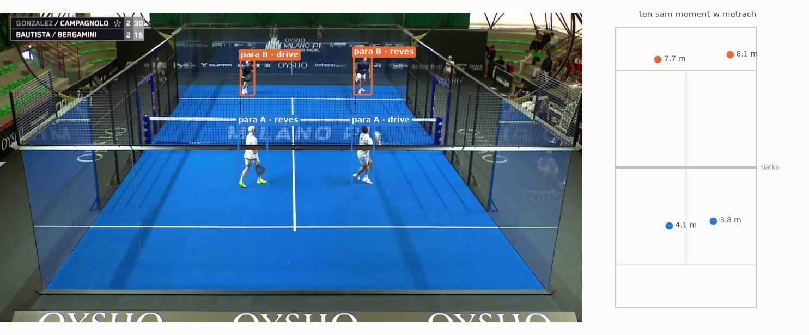
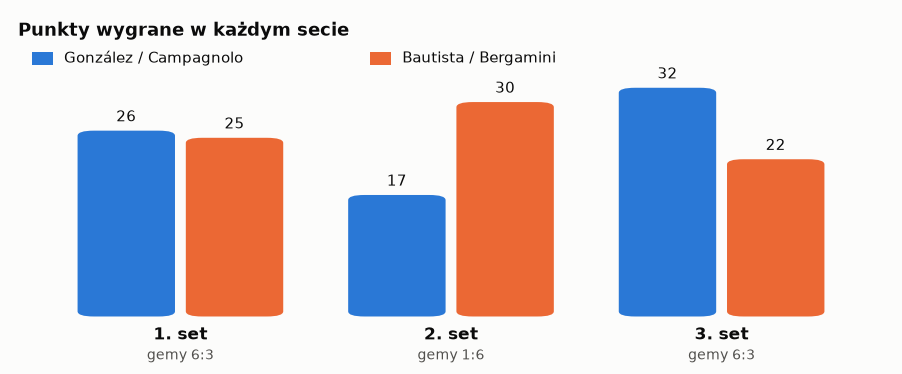
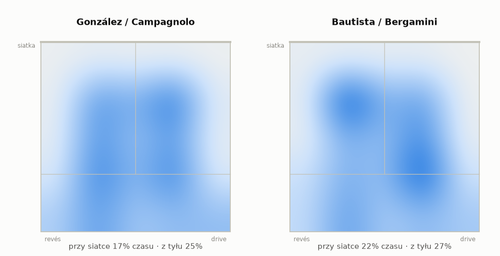
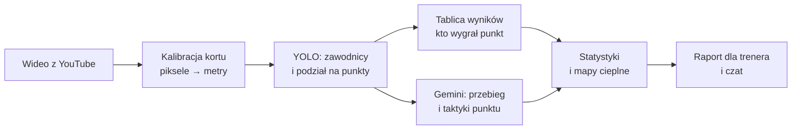
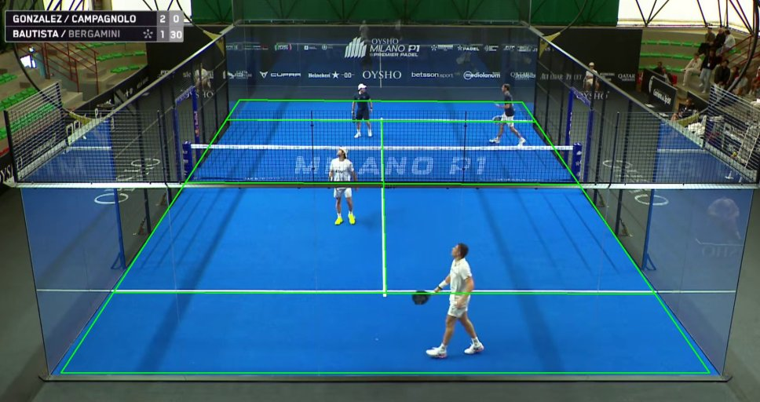
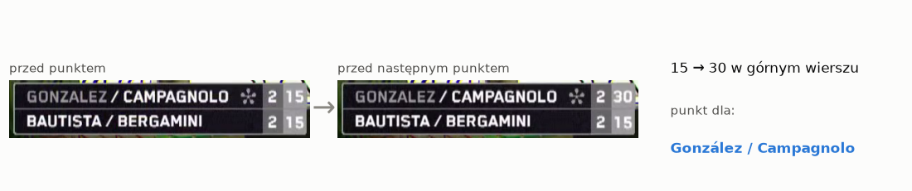
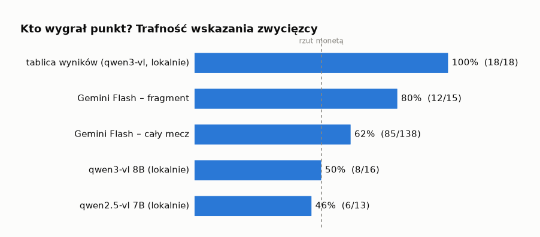

# TacticLLM

**Analiza taktyczna meczów padla z transmisji wideo i raport dla trenera napisany przez model językowy.**

Podajesz link do meczu na YouTube, a dostajesz: pozycje zawodników w metrach, kto i jak długo trzymał siatkę, mapy cieplne, zwycięzcę każdego punktu, taktyki obu par z ich skutecznością oraz raport z konkretnymi wskazówkami treningowymi.



<sub>Klatka z oficjalnej powtórki Premier Padel (Milano P1 2025, 1/8 finału: González/Campagnolo vs Bautista/Bergamini).</sub>

## Co potrafi

- **Śledzi zawodników** (YOLO) na ujęciach z głównej kamery i przelicza ich pozycje z pikseli na metry kortu.
- **Dzieli transmisję na punkty**, pomijając powtórki, zbliżenia i przerwy – także wtedy, gdy realizator nie przełączy kamery między punktami.
- **Rozpoznaje pary po kolorze koszulek**, również po każdej zmianie stron.
- **Odczytuje tablicę wyników** lokalnym modelem wizyjnym i na tej podstawie ustala, kto wygrał każdy punkt.
- **Opisuje przebieg punktu i taktyki** (lob i przejęcie siatki, chiquita, gra środkiem, bandeja/víbora, smecz x3/x4, obrona po szybie…) modelem wizyjnym Gemini.
- **Liczy statystyki taktyczne**: czas przy siatce i z tyłu, przejęcia i utraty siatki, skuteczność taktyk, wygrane według ustawienia i długości wymiany, podział ról drive/revés.
- **Pisze raport dla trenera** i pozwala zadawać pytania o mecz w czacie.

## Przykład: cały mecz

González/Campagnolo vs Bautista/Bergamini, 6:3 1:6 6:3 – 96 minut nagrania, 152 punkty. Zwycięzcę 140 punktów program odczytał z tablicy wyników, pozostałe 12 ocenił model wideo. Ciekawostka, którą widać dopiero w liczbach: przegrani zdobyli w całym meczu **więcej punktów** (77 do 75) – wszystko rozstrzygnął drugi i trzeci set.

<picture>
  <source media="(prefers-color-scheme: dark)" srcset="docs/img/sets-dark.png">
  
</picture>

<picture>
  <source media="(prefers-color-scheme: dark)" srcset="docs/img/heatmaps-dark.png">
  
</picture>

Fragmenty raportu wygenerowanego automatycznie (Gemini, na podstawie statystyk i opisów wszystkich punktów):

> **Set 2:** Bautista/Bergamini podnieśli wskaźnik lobów aż do 0.61 na punkt, całkowicie neutralizując ofensywę rywali. Para A zaczęła popełniać błędy przy próbach smeczu (skuteczność taktyki spadła z 58.3% do 25.0%).
>
> **Set 3:** González/Campagnolo wyciągnęli wnioski ze złej passy. Zwiększyli częstotliwość *serve and volley* aż do 48.1% punktów (wygrywając 65.4% z nich).
>
> **Dominacja przy siatce w wykończeniu akcji:** gdy González / Campagnolo kończyli punkt w formacji przy siatce, ich skuteczność wynosiła **67.9%** (28 punktów). Gdy dawali się zepchnąć do tyłu, ich win rate spadał do zaledwie **31.0%**.
>
> **Różnica w obronie po szybie:** Bautista / Bergamini wygrali **55.9%** z 34 punktów granych w obronie, podczas gdy González / Campagnolo zdołali wygrać tylko **36.7%** z 30 takich akcji.
>
> **Wskazówka dla Bautisty / Bergaminiego:** utrzymać wysoki wskaźnik lobowania od początku meczu, ale wywierać większą presję przy własnym serwisie – spadek skuteczności serwisu z 70.6% w 2. secie do 50.0% w 3. otworzył rywalom drogę do powrotu.

Każdą z tych liczb można sprawdzić w `stats.json` – raport ich nie wymyśla, tylko interpretuje.

## Jak to działa



**Kalibracja.** Na jednej klatce zaznacza się 4 punkty kortu o znanym położeniu (narożniki albo końce linii serwisowych). Z nich program wylicza perspektywę i od tej chwili każdy piksel podłogi zamienia na metry. Kamera transmisyjna w padlu się nie rusza, więc wystarczy to zrobić raz na film.



**Kto wygrał punkt.** Model wizyjny, który ogląda wymianę, myli się dość często. Grafikę z wynikiem odczytuje za to bezbłędnie. Program czyta więc tablicę tuż przed każdym punktem i porównuje z odczytem przed następnym.



Porównanie na fragmencie 1. seta (18 punktów sprawdzonych ręcznie) i na całym meczu (138 punktów, w których zwycięzcę znamy z tablicy):

<picture>
  <source media="(prefers-color-scheme: dark)" srcset="docs/img/accuracy-dark.png">
  
</picture>

| Metoda | Trafne | |
|---|---|---|
| Tablica wyników (qwen3-vl, lokalnie) | 18/18 | 100% |
| Gemini Flash 3.x (opis wideo) – fragment | 12/15 | 80% |
| Gemini Flash 3.x (opis wideo) – cały mecz | 85/138 | 62% |
| qwen3-vl 8B (lokalnie, opis klatek) | 8/16 | 50% |
| qwen2.5-vl 7B (lokalnie, opis klatek) | 6/13 | 46% |

## Ile to kosztuje i ile trwa

Wszystko poza opisem punktów działa lokalnie i za darmo. Zmierzone na całym meczu (96 minut, 153 punkty) na RTX 4060 Ti 16 GB:

| Krok | Gdzie | Czas | Koszt |
|---|---|---|---|
| Pobranie | yt-dlp | zależy od łącza (tu 56 min) | 0 |
| Wykrywanie zawodników | GPU, YOLO | 21 min | 0 |
| Tablica wyników | GPU, Ollama | 7 min | 0 |
| Opisy punktów | Gemini | płatny plan: 40 min; darmowy: 20 punktów dziennie na model | ok. 1,5 USD (od 2027 ok. 3 USD) albo 0 |
| Raport | Gemini | ok. 30 s | 0 (mieści się w darmowym planie) |

Na płatnym planie Gemini warto ustawić miesięczny limit wydatków projektu (AI Studio → **Spend** → **Monthly spend cap**).

## Wymagania

- Python 3.10+
- [ffmpeg](https://ffmpeg.org/) w `PATH` (Windows: `winget install ffmpeg`)
- karta NVIDIA z CUDA – do YOLO i lokalnych modeli wizyjnych (ustawienia w `.env.example` są dobrane pod 16 GB VRAM; na CPU działa, ale bardzo wolno)
- [Ollama](https://ollama.com/) – do odczytu tablicy wyników (`qwen3-vl:8b-instruct`)
- klucz API Google (Gemini: opisy punktów i raport) – darmowy z [Google AI Studio](https://aistudio.google.com); opcjonalnie Anthropic (raport przez Claude)

## Instalacja

```bash
python -m venv .venv
.venv\Scripts\activate          # Linux/macOS: source .venv/bin/activate
```

### 1. PyTorch z CUDA

Zainstaluj go **przed** resztą zależności, inaczej `ultralytics` pociągnie wersję tylko na CPU. Wybierz wersję CUDA na [pytorch.org](https://pytorch.org/get-started/locally/), np.:

```bash
pip install torch torchvision --index-url https://download.pytorch.org/whl/cu128
```

Sprawdzenie:

```bash
python -c "import torch; print(torch.cuda.is_available(), torch.cuda.get_device_name(0))"
```

### 2. TacticLLM

```bash
pip install -e ".[all,dev]"
```

Grupy zależności: `vision` (wideo, YOLO, mapy cieplne), `annotate` (Ollama, Gemini), `llm` (Agno, Claude, Gemini), `dev` (pytest). Same statystyki i testy działają bez żadnej z nich.

### 3. Ollama

Zainstaluj Ollamę, a potem pobierz modele:

```bash
ollama pull qwen3-vl:8b-instruct   # odczyt tablicy wyników
ollama pull qwen2.5vl:7b           # opcjonalnie: opisy punktów lokalnie
ollama pull qwen3:14b              # opcjonalnie: raport lokalnie (TACTIC_REPORT_PROVIDER=ollama)
```

Ollama musi działać w tle (`ollama serve`, domyślnie `http://localhost:11434`).

### 4. Konfiguracja

```bash
copy .env.example .env          # Linux/macOS: cp .env.example .env
```

Najważniejsze zmienne (pełna lista w [config.py](src/tacticllm/config.py), prefiks `TACTIC_`):

| Zmienna | Domyślnie | Znaczenie |
|---|---|---|
| `GOOGLE_API_KEY` | – | klucz do Gemini |
| `TACTIC_ANNOTATOR` | `ollama` | opisy punktów: `gemini` (zalecane) albo `ollama` |
| `TACTIC_VIDEO_MODEL` | `gemini-3.6-flash` | model Gemini do opisów punktów |
| `TACTIC_REPORT_PROVIDER` | `anthropic` | raport: `gemini` (darmowy plan wystarcza), `anthropic` (Claude) albo `ollama` |
| `TACTIC_GEMINI_REPORT_MODEL` | `gemini-3.6-flash` | model Gemini do raportu; przy przeciążeniu: `gemini-3-flash-preview` |
| `ANTHROPIC_API_KEY` | – | klucz do raportu przez Claude |
| `TACTIC_SCOREBOARD_MODEL` | `qwen3-vl:8b-instruct` | model Ollamy do odczytu tablicy wyników |
| `TACTIC_YOLO_WEIGHTS` | `yolo11l.pt` | wagi YOLO (pobierane automatycznie) |
| `TACTIC_DEVICE` | `0` | `0` = pierwsze GPU, `cpu` = bez GPU |
| `TACTIC_ANALYSIS_FPS` | `10` | ile klatek na sekundę analizuje YOLO |

## Użycie

Wszystkie pliki jednej analizy trafiają do katalogu `--run` (domyślnie `runs/mecz`).

### Dane meczu

Skopiuj [examples/match.yaml](examples/match.yaml) i uzupełnij pary i zawodników. `start_side: near` ma para, która w **pierwszym punkcie fragmentu** stoi bliżej kamery. Nazwiska służą też do dopasowania wierszy tablicy wyników do par. `focus_team` decyduje, dla kogo są wskazówki w raporcie.

### Wszystko naraz

```bash
tacticllm analyze "https://www.youtube.com/watch?v=..." --start 1:02:00 --end 1:45:00 --match mecz.yaml --scoreboard "85,50,610,132" --backend gemini --run runs/final
```

Kroki, które już mają wynik w katalogu (wideo, kalibracja, segmenty, tablica), są pomijane, a opisy punktów można wznowić po przerwaniu.

### Krok po kroku

```bash
tacticllm download "https://www.youtube.com/watch?v=..." --start 1:02:00 --end 1:45:00 -r runs/final
tacticllm calibrate -r runs/final --at 0:10
tacticllm track -r runs/final
tacticllm scores -r runs/final --box "85,50,610,132" --match mecz.yaml
tacticllm points -r runs/final
tacticllm annotate -r runs/final --backend gemini
tacticllm stats -r runs/final --match mecz.yaml
tacticllm report -r runs/final
tacticllm chat -r runs/final
```

1. **download** – pobiera film albo tylko fragment (link obsługiwany przez yt-dlp lub ścieżka do pliku).
2. **calibrate** – na klatce z czasu `--at` (musi to być widok z głównej kamery!) klikasz 4 narożniki podłogi kortu: dalszy-lewy, dalszy-prawy, bliższy-prawy, bliższy-lewy. Backspace cofa, Enter zapisuje. Gdy narożniki są poza kadrem, użyj `--kind service` i kliknij końce linii serwisowych przy ścianach. Bez okna: `--corners "x,y;x,y;x,y;x,y"`. Sprawdź `calibration_preview.jpg` – linie kortu muszą pokrywać się z obrazem.
3. **track** – wykrywa zawodników na ujęciach z głównej kamery i dzieli film na punkty (`segments.json`). Gdy realizator nie przełączy kamery między punktami, ujęcie jest dzielone na przerwie przed kolejnym serwisem.
4. **scores** – odczytuje tablicę wyników przed każdym punktem i ustala zwycięzcę punktu (`scores.json`). `--box` to prostokąt z grafiką wyniku w pikselach klatki (x1,y1,x2,y2 – zapamiętywany); bez niego model dostaje całą klatkę. Grafika rośnie w prawo z każdym setem, więc prostokąt musi mieć zapas na kolumny trzech setów i punktów (najlepiej zmierz go na klatce z 3. seta). Zwycięzca i numer seta z tablicy mają pierwszeństwo przed oceną modelu z `annotate`.
5. **points** – lista wykrytych punktów do szybkiej weryfikacji.
6. **annotate** – model wizyjny opisuje każdy punkt: przebieg, zakończenie i taktyki (`annotations.json`). Na darmowym planie Gemini po wyczerpaniu dziennego limitu uruchom tę samą komendę następnego dnia – gotowe punkty są pomijane. `--limit 10 --model qwen3-vl:8b-instruct --out ann_qwen3.json` pozwala porównać modele na kilku punktach.
7. **stats** – statystyki (`stats.json`) i mapy cieplne (`heatmaps/`).
8. **report** – raport taktyczny w Markdown (`report.md`).
9. **chat** – rozmowa z agentem o meczu, np. „dlaczego przegrali 2. seta?”.

### Pliki w katalogu analizy

| Plik | Zawartość |
|---|---|
| `video.mp4` | analizowany fragment |
| `calibration.json`, `reference.jpg`, `calibration_preview.jpg` | kalibracja kortu i prostokąt tablicy wyników |
| `segments.json` | punkty i pozycje zawodników (metry) |
| `scores.json` | wynik z tablicy przed każdym punktem i zwycięzca punktu |
| `annotations.json` | opisy punktów z modelu wizyjnego |
| `stats.json`, `heatmaps/` | statystyki i mapy cieplne |
| `report.md` | raport dla trenera |

## Ograniczenia

- Brak śledzenia piłki – zwycięzca punktu pochodzi z tablicy wyników, a przebieg i taktyki z modelu wizyjnego (62–80% trafności co do zwycięzcy, więc opisy traktuj jako orientacyjne). Gdy opis przeczy tablicy, jego zakończenie i ostatnie uderzenie nie trafiają do statystyk.
- „drive” / „revés” to **pozycja** na korcie, a nie konkretny zawodnik – po zamianie stron w trakcie wymiany statystyki obu się mieszają.
- Ujęcia głównej kamery są rozpoznawane przez porównanie z klatką z kalibracji; zmiana kamery lub oświetlenia może zgubić punkty.
- Prostokąt tablicy wyników trzeba podać dla każdej transmisji osobno – z zapasem na kolumny wszystkich setów.

## Testy

```bash
pytest
```

Testy nie wymagają GPU, wideo ani modeli.
